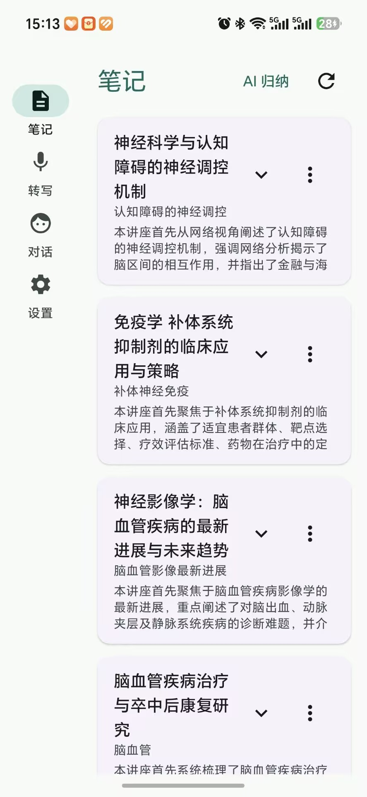
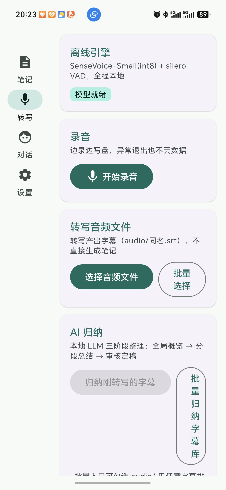

# 随心记 SuixinJi

> 依靠手机本地asr和llm的笔记助手

你有没有遇到过不发PPT的必修课？
你有没有遇到过需要图文总结的会议纪要？
随心记是一个安卓端笔记应用，专为课堂/讲座/会议场景设计。它把「录音 → 转写 → 整理成笔记」这条链路放在端侧：语音识别与本地大语言模型默认离线运行；也可以显式切换到你自己配置的 OpenAI 兼容云端模型。本地模型约 0.5~2.6G，一条在手机本地计算得到的课堂笔记会按照 markdown 语法出现在你的手机文件夹。你可以把本软件的项目文件夹用手机笔记软件打开，并使用任意支持WebDAV协议的网盘同步到obsidian这类笔记库！

## 它能做什么

```
录音 / 导入音频
      │
      ▼
SenseVoice 离线转写（silero VAD 分段）──→ audio/*.srt（可编辑改错字）
      │
      ▼
Gemma 端侧 LLM 三阶段归纳 ──────────→ *.md 结构化笔记
   ① 全局概览（题目+摘要）
   ② 分段总结（按时间切片）
   ③ 审核定稿（打回重做对应部分 + 自动生成自测题）
      │
      ▼
实时预览 Markdown 编辑器 / 照片按拍摄时刻自动插图 / WebDAV 同步
```

## 特性

- **默认离线**：ASR（SenseVoice-Small int8 + silero VAD）与本地 LLM（Gemma-4 E2B / Qwen2.5 轻量档，litertlm）都在端侧运行；只有显式开启云端模型时才需要网络
- **三阶段归纳 agent**：概览 → 分段 → 审核定稿，审核不通过会按编号打回重做对应部分，最终笔记自带「自测与思考」题目
todo：自定义json流式结构，允许不同模型、提示词、笔记结构
- **批量管线**：音频批量转写、字幕批量归纳，各自独立排队互不阻塞；前台服务 + 通知栏进度，长任务可离开应用等待
- **规范格式**：授权一个文件夹作为笔记库，可以用其他笔记软件打开并设置为目录同步，md/srt/录音/插图按规范目录组织，随时可被其他工具接管，有必要时srt可以作为字幕文件
- **照片自动插图**：读取 EXIF 拍摄时刻，按录音时段自动匹配插入对应小节
- **实时预览编辑器**：逐行块级编辑，所见即所得，改完错字可一键重新归纳
- **本地对话**：与端侧模型自由对话，兼作推理引擎测试页
- **云端模型可选**：OpenAI 兼容接口，适合本地内存不足的机型；开启前有明确确认，Key 加密保存在本机，日志不记录 Key 与正文
todo：一次性输出回答 → 流式输出本地小模型回答

## 1.1.0 更新

- **麒麟/低内存兼容**：新增 Qwen2.5 0.5B / 1.5B 本地模型档位。HUAWEI BKY-W20（Kirin T90 / 12GB）实测 Gemma-4 E2B 在 LiteRT 的 GPU/NPU/CPU 后端都会因内存峰值被系统杀死；Qwen2.5 0.5B CPU 可加载（约 581MB native），1.5B 也可加载（约 746MB native），但 1.5B CPU 很慢，只建议作为最小本地兜底。
- **云端模型**：设置页可全局切换「本地模型 / 云端模型（OpenAI 兼容）」。接口强制 HTTPS；Key 用 Android Keystore AES-GCM 加密后存 DataStore；日志只记录 host/耗时/字符数，不记录 Key 和正文；开启云端前有确认弹窗。
- **转写页按钮修复**：「归纳 / 批量」改为等宽整行按钮，不再出现长文案挤压/竖排。
- **本地模型档位**：Gemma-4 E2B / Qwen2.5 0.5B / Qwen2.5 1.5B 可在设置页选择并分别导入；模型文件仍由用户自行准备。
- **输出预算按长度浮动**：不再按概览/分段/审核写死 max token，改为按 prompt 长度给预算；自测题只做重复行去重。
- **网络限流退避**：云端返回 402/429 时按 `Retry-After` 或 `Retry after Ns` 自动等待重试。
- **诊断**：会话日志头记录 SoC/board；模型状态区分「文件已导入」和「本机可加载」。

> 1.1 的麒麟 NPU（HiAI）接入尚未完成，计划放到 1.2；当前麒麟上推荐「Qwen2.5 0.5B + CPU」或云端模型。

## 隐私

- **默认本地**：不开启云端模型时，ASR、LLM 归纳、对话都在手机本地完成，不依赖网络端服务。
- **云端是显式可选项**：只有你在设置页选择「云端模型」并确认后，AI 归纳才会把字幕/提示词发送到你配置的 OpenAI 兼容 API。发送内容不再受本应用控制，请自行确认服务商的数据政策。
- 应用不内置任何云端 API Key；你填写的 Key 用 Android Keystore AES-GCM 加密保存在本机，日志不记录 Key 和请求正文。
- 对隐私敏感的内容，建议使用本地模型，或在完全离线的环境下处理。

## 系统要求与模型

| 项 | 要求 |
|---|---|
| 系统 | Android 12+（`minSdk = 31`），且必须是 arm64 真机 |
| 内存 | 建议 8GB+；Gemma 约 2.5GB，Qwen2.5 0.5B 约 0.5GB。12GB 麒麟机型加载 Gemma 可能 OOM，建议 Qwen 轻量档或云端 |
| ASR 模型 | SenseVoice-Small int8（~230MB）+ silero-vad.onnx |
| LLM 模型 | Gemma-4 E2B int4（~2.5GB）或 Qwen2.5 0.5B/1.5B（需自行转换，~0.5/1.5GB） |

模型需在应用内「设置」页手动导入，以下是需要导入的项目依赖：

| 模型 | 大小 | 许可 | 官方下载地址 |
|---|---|---|---|
| SenseVoice-Small int8（`model.int8.onnx` + `tokens.txt`） | ~230MB | Apache-2.0 | [HuggingFace: csukuangfj/sherpa-onnx-sense-voice-zh-en-ja-ko-yue-2024-07-17](https://huggingface.co/csukuangfj/sherpa-onnx-sense-voice-zh-en-ja-ko-yue-2024-07-17)，或 [sherpa-onnx asr-models Release](https://github.com/k2-fsa/sherpa-onnx/releases/tag/asr-models) 内同名 tar.bz2 |
| silero-vad（`silero_vad.onnx`） | 629KB | MIT | [GitHub: snakers4/silero-vad](https://github.com/snakers4/silero-vad)（sherpa-onnx asr-models Release 同样附带） |
| Gemma-4 E2B int4（`gemma-4-E2B-it.litertlm`） | ~2.5GB | [Gemma Terms of Use](https://ai.google.dev/gemma/terms) | [ModelScope: litert-community/gemma-4-E2B-it-litert-lm](https://modelscope.cn/models/litert-community/gemma-4-E2B-it-litert-lm)，或 [HuggingFace: litert-community](https://huggingface.co/litert-community)（Gemma 需登录接受条款） |
| Qwen2.5 0.5B / 1.5B Instruct（转换为 `.litertlm`） | ~0.5 / 1.5GB | Apache-2.0 | [ModelScope: Qwen/Qwen2.5-0.5B-Instruct](https://modelscope.cn/models/Qwen/Qwen2.5-0.5B-Instruct)、[Qwen/Qwen2.5-1.5B-Instruct](https://modelscope.cn/models/Qwen/Qwen2.5-1.5B-Instruct)；仓库内 `scripts/convert_model.sh qwen-0.5b` / `qwen-1.5b` 可转换 |

> asr的3个文件需要命名规范，放在同一个文件夹下导入文件夹；谷歌的模型可以单文件直接导入

## 安装方式

### 从源码构建

**前置环境**

| 组件 | 版本 | 说明 |
|---|---|---|
| JDK | 17 或 21 | AGP 8.13.2 要求；实测 17.0.20 |
| Gradle | 8.13 | 无需安装，`./gradlew` 按 wrapper 自动拉取（Windows 见下方说明） |
| Android SDK | `platforms;android-36`、`build-tools;36.0.0`、`ndk;27.2.12479018`(r27c)、`cmake;3.22.1`、`platform-tools` | 见第 1 步 |
| CMake | ≥3.22，且**版本号必须与 `app/build.gradle.kts` 里 `cmake { version = ... }` 完全一致** | 见第 3 步，这一步最容易卡住 |

> 注意：`gradle.properties` 里设置了 `android.builder.sdkDownload=false`，AGP **不会**自动下载 SDK，缺组件会报 `Failed to find target with hash string 'android-36'`，必须手动准备。
> 本仓库未提供 `gradlew.bat`，Windows 请先安装 Gradle 8.13，然后把下文所有 `./gradlew` 换成 `gradle`。

**0) 克隆项目、下载 ASR 引擎 AAR**

```bash
git clone https://github.com/Eli-Zxh/suixinji && cd suixinji
chmod +x gradlew          # 压缩包/网页分发常丢可执行位，丢了会报 Permission denied

mkdir -p app/libs
curl -L -o app/libs/sherpa-onnx-1.12.14.aar \
  https://github.com/k2-fsa/sherpa-onnx/releases/download/v1.12.14/sherpa-onnx-1.12.14.aar

# 校验：官方 v1.12.14 默认 Android AAR，39,988,286 字节
shasum -a 256 app/libs/sherpa-onnx-1.12.14.aar
# 期望 5a629a899888cb2760e245d9d5340858b15591aee7fa13644cf57199ff2829b9
```

同一 release 里还有 `sherpa-onnx-1.12.14-rknn.aar`（瑞芯微 NPU 变体）和 `sherpa-onnx-static-link-onnxruntime-1.12.14.aar`（静态链接 onnxruntime），本项目用的是**不带后缀的默认包**。文件名必须与 `app/build.gradle.kts` 中 `implementation(files("libs/sherpa-onnx-1.12.14.aar"))` 完全一致，换版本要同步改这一行。

**1) 准备 Android SDK 组件**

`sdkmanager` 不在仓库里，先拿到它，二选一：

- **省事**：安装 Android Studio，它会自动装好 SDK（macOS `~/Library/Android/sdk`，Windows `%LOCALAPPDATA%\Android\Sdk`）。这种情况下跳过下面的下载命令，直接把该目录填进第 2 步的 `sdk.dir`。
- **命令行**：下载 *Command line tools* 压缩包，解压成 `<你的SDK目录>/cmdline-tools/latest/`，`sdkmanager` 位于其 `bin/` 下。

```bash
SDK_ROOT="$(pwd)/sdk"
CMD="$SDK_ROOT/cmdline-tools/latest/bin/sdkmanager"

# 必须先接受许可，否则下载 NDK 时报 "... license not accepted"
yes | "$CMD" --sdk_root="$SDK_ROOT" --licenses

"$CMD" --sdk_root="$SDK_ROOT" \
  "platform-tools" "platforms;android-36" "build-tools;36.0.0" \
  "ndk;27.2.12479018" "cmake;3.22.1"
```

- NDK 必须落在 `sdk/ndk/27.2.12479018`（AGP 按目录名发现版本）。
- `platform-tools` 只在第 6 步 `adb install` 时需要，纯构建可省。
- 全部 Maven 依赖（AGP、Kotlin、Compose、LiteRT-LM、okhttp、spotless）都从 `settings.gradle.kts` 里配置的阿里云镜像解析，clone 后无需再配仓库源。若该镜像在你的网络下不可达，可在同一文件的两个 `repositories` 块里补上 `google()` 与 `mavenCentral()`。

**2) 配置 `local.properties`（仓库不含此文件，需自建）**

```properties
sdk.dir=/绝对路径/suixinji/sdk
```

- 只想用环境变量的话，可以不建这个文件，改用第 4 步的 `export ANDROID_HOME=...`，二者取其一。
- 如果你走第 3 步的「路 B」（用系统/ brew 的 CMake 4.x），再加一行 `cmake.dir=/opt/homebrew`（AGP 会调用 `<该目录>/bin/cmake`）。

**3) 对齐 CMake 版本（关键，别跳过）**

`app/build.gradle.kts` 里 `externalNativeBuild { cmake { version = "4.0.2" } }` 是**精确版本要求**：AGP 只会在 `<sdk>/cmake/4.0.2/` 里找，找不到就终止构建；而 `sdkmanager` 一般装不到 4.0.2，Linux 也没有 brew。所以先做一次选择：

- **路 A（推荐，一次改完全平台通用）**：把 `app/build.gradle.kts` 中的 `version = "4.0.2"` 改成第 1 步装好的版本，例如 `"3.22.1"`，并且**不要**设置 `cmake.dir`。native 源码只声明了 `cmake_minimum_required(VERSION 3.22)`（见 `app/src/main/cpp/CMakeLists.txt`），里面没有用到 4.x 专有语法，降到 3.22.x 是安全的。SDK 的 cmake 包自带 ninja，走这条路无需再装 ninja。
- **路 B（本机已有 4.x）**：保留 `4.0.2`，在 `local.properties` 里加 `cmake.dir=/opt/homebrew`（macOS 需 `brew install cmake ninja`，AGP 会到 `<cmake.dir>/bin/` 找 cmake 与 ninja）。

自检是否走对：执行第 4 步后不再出现 `No version of CMake in the SDK` / `CMake 4.0.2 not found` 这类提示。

**4) 构建 debug 包**

```bash
export ANDROID_HOME="$(pwd)/sdk"    # 第 2 步已写 sdk.dir 可省略
./gradlew assembleDebug

ls app/build/outputs/apk/debug/
# 产物：suixinji-v1.1.0-debug.apk —— 文件名由 versionName 自动生成（app/build.gradle.kts）
```

到此为止就是「复刻成功」：拿到一个可安装的 debug APK。后面三步属于发布与使用层面，与能否构建无关。

**5) 打 release 包（可选，仅当你需要 ProGuard 混淆版）**

`suixinji.keystore` 与密码**都不入库**（`*.keystore` 已在 `.gitignore` 中）。fork 后自行生成：

```bash
keytool -genkeypair -v -keystore suixinji.keystore -alias suixinji \
        -keyalg RSA -keysize 2048 -validity 10000
```

然后在 `local.properties` 填 `ks.store.password` / `ks.key.password`，再 `./gradlew assembleRelease`。
自己签名的 APK 与我发布的 release 包**不能互相覆盖升级**（签名不同），日常调试用 debug 包即可。

**6) 推送到手机安装**

```bash
adb install app/build/outputs/apk/debug/suixinji-v1.1.0-debug.apk
```

注意目录是 `outputs`（带 s），文件名带版本号，不是常见的 `app-debug.apk`。

**7) 导入模型（运行时行为，与构建无关）**

- ASR：一个文件夹内放 **3 个文件名精确匹配**的文件（代码按名硬取，改名会提示「未找到」）
  ```
  model.int8.onnx   tokens.txt   silero_vad.onnx
  ```
- LLM：单个 `.litertlm` 文件（文件名不限，Gemma-4 E2B int4，约 2.4GB）。
- 自行转换：`bash scripts/convert_model.sh qwen-1.5b`（需 `pip install litert-torch-nightly modelscope`，支持 `qwen-0.5b|qwen-1.5b|qwen-3b|gemma-3-1b`）。

**复刻排错对照**

| 报错关键字 | 原因 | 回到哪一步 |
|---|---|---|
| `Failed to find target with hash string 'android-36'` | 平台未装，或 `sdk.dir` / `ANDROID_HOME` 指错 | 1、2 |
| `No version of CMake in the SDK` / `CMake ... not found` | `cmake { version }` 与实际装的版本不一致 | 3（走路 A） |
| `... license ... not accepted` | 没接受 SDK 许可 | 1 |
| `Could not find ... sherpa-onnx-1.12.14.aar`、`NoSuchFileException: app/libs/...` | AAR 没下载，或文件名/版本与 `build.gradle.kts` 不匹配 | 0 |
| `./gradlew: Permission denied` | 可执行位丢失 | 0 的 `chmod +x gradlew` |
| `Unsupported class file major version ...` | JDK 版本过新或过旧 | 换 JDK 17/21 |
| `Could not resolve com.google.ai.edge.litertlm:litertlm-android` | 镜像源不可达（网络/代理） | 见 `settings.gradle.kts` 仓库配置 |
| 安装报 `INSTALL_FAILED_OLDER_SDK` | 设备低于 Android 12 | 换 Android 12+ arm64 真机 |
| 装上了但转写/归纳立刻崩或无响应 | x86 模拟器没有 arm64 native 库 | 必须真机 |

**运行侧限制**

- 原生部分只编译 `arm64-v8a`（`abiFilters` 已裁掉 x86/armeabi-v7a），模拟器跑不了 ASR 与 LLM。
- OpenCL 采用链接期 shim（GPU 探活通道）+ 原生崩溃信号捕获；构建期空壳 `libOpenCL.so` 已由 `packaging.jniLibs.excludes` 挡在 APK 之外，**请勿改动这条 excludes**，否则 litertlm 运行期会 dlopen 命中无符号的空壳库导致 GPU 通道失效。
- 部分 ROM（如荣耀 MagicOS）封死应用侧 OpenCL 加载通道，属已知现象，见「已知限制」。

### 从 Release 下载

仓库右侧 Releases 里下载 `suixinji-v1.1.0-release.apk`，直接安装（需 Android 12+ 的 arm64 机型）。模型仍要按第 7 步自行下载导入——模型和 ASR 引擎 AAR 都不在仓库里。

如果你不想用 git，也可以下载 Release 页面的 *Source code (zip)* 源码包，解压后**同样要从第 0 步的 AAR 下载开始执行**，源码包里不含它。

### 使用说明
首页是笔记卡片，可以从右侧卡片点击查看每个笔记markdown预览或者对于转写的记录进行AI总结。
对话页是简易的手机本地llm对话。

从“转写音频文件”里选择你要识别的音频，可以选择多个文件进行转写。
随后可以在卡片页或者下面选择进行总结。


## 技术路线

手机端侧的模型能力有限，本项目为了保证能笔记生成的是有效内容，做了这样的三步骤harness:
```
① 全局概览：给出题目+摘要
      │摘要当场生成，指导笔记总结的方向
      ▼
② 分段总结：按时间切片，多次调用分别总结，对于课程篇幅尽可能适配
      │分阶段把小标题和这部分的主要内容进行总结
      ▼
③ 审核定稿：提示词隔离，不看srt原文
      │判断笔记质量，不达标的小段交给分段处理返工；
      |质量合格则给出思考
      ▼
照片按录音时间段选择这段时间拍摄的照片自动插图
```
这段工作流和对应每个阶段提示词，无法由用户自行修改。且未必是一个好的harness思路，但实测产出的笔记相对不挑领域，质量相对稳定可以用。
图片插入是根据拍照时间和章节位置简单计算得到的，做不到足够精确，需要在复习的时候人工手动审核。

## 代码导读

本仓库不附带设计文档，思路请直接读源码（各文件头部有中文注释说明设计取舍）。按链路入口：

| 想弄明白的部分 | 从这里读 |
|---|---|
| 转写链路 | `ui/screens/TranscribeController.kt`、`asr/SenseVoiceEngine.kt`、`audio/AudioDecoder.kt` |
| 三阶段归纳 harness 与提示词 | `llm/NoteSummarizer.kt`、`llm/NoteLlmEngine.kt`、`note/NoteComposer.kt` |
| 长任务队列、断点接续、崩溃现场 | `util/TaskTrace.kt`、`audio/CrashRecovery.kt`、`util/CrashSignal.kt`、`task/TaskNotify.kt` |
| GPU/OpenCL 探活与 shim | `llm/OpenClLoader.kt`、`app/src/main/cpp/opencl_shim.c`、`vndkstub.c`、`opencl_probe.c` |
| 实时预览编辑器 | `app/src/main/assets/editor.html`、`ui/screens/NoteScreen.kt` |
| 笔记库目录规范与 WebDAV | `workspace/WorkspaceStore.kt`、`workspace/WebDavClient.kt`、`data/SettingsStore.kt` |
| 模型导入 | `workspace/ModelImporter.kt`、`ui/screens/SettingsScreen.kt` |
| SRT 读写 | `srt/SrtParser.kt`、`srt/SrtWriter.kt` |

## 已知限制

- 部分 ROM（如荣耀 MagicOS）封死应用侧 OpenCL 加载通道，GPU 推理不可用，自动回退 NPU/CPU；NPU 实测可用但慢于 CPU
- HUAWEI BKY-W20（Kirin T90 / 12GB）：Gemma-4 E2B 在 LiteRT 的 GPU/NPU/CPU 后端均可能因内存峰值被系统杀死；请选 Qwen2.5 0.5B + CPU，或云端模型。华为 HiAI NPU 接入计划在 1.2。
- Qwen2.5 1.5B CPU 可加载、质量优于 0.5B，但速度很慢（实测 3.5K 字切片约 2~5 分钟/次），只建议作为最小本地兜底。
- 端侧 LLM 归纳速度：单篇 1~2 小时课程约 5~15 分钟（视机型与后端）
- litertlm 内部有 10 分钟单会话超时，超长输入靠分片规避

## 注意事项以及作者的话

1.录音功能不属于本项目必要的功能，尽可能用手机自带录音器，本软件录音器仅起到对可能存在的特殊设备的备选方案，没有做全面测试，没做录音回放功能。
2.手机的NPU是一个提出了很多年的东西，本项目初衷就是很想看看手机端的llm和NPU现在到底能做到什么样的程度。目前看来整体效果属于勉强可以用，谷歌的小模型意想不到的还挺聪明。
3.对于数学、latex方程这一类特殊场景以及其他复杂笔记要求，效果预计不是很好。对于harness的改进方式期待您的发言！
4.其他平台的适配（IOS\Harmony）以及各厂商AI功能的调用是个很复杂的问题工作量很大，且IOS端需要付费开发者认证。我会根据大家反馈实用性怎么样考虑做不做，如果有人赞助就好了doge
5.本项目处于迭代状态，欢迎您的issue反馈问题、欢迎大佬的PR！！欢迎感兴趣的朋友多多交流

## Todolist

1. 修复机型、芯片、平台兼容性问题
2. 后端处理架构升级迭代：添加 json 提示词工作流，允许自定义提示词和回调以及处理逻辑
3. 编辑器优化：优化前端性能增加可编辑性，给出基本的编辑能力和流畅的加载体验
4. ~~允许云端 llm 的 api 自行选择接入~~（1.1 已完成 OpenAI 兼容接口）
5. 增加其他导出格式，如导出成docx等
6. 添加鸿蒙系统和 iOS 系统打包版本（对测试和上架商店无能为力）

## 贡献

提 issue 和 PR 前请套用 `.github/` 里的模板（首次提 issue 会自动给出表单）：

- 报 bug 请带上机型/ROM/内存/模型信息与日志；日志 zip 里可能含你的笔记内容，公开前请自行脱敏。
- PR 请在本地跑通 `./gradlew spotlessCheck testDebugUnitTest assembleDebug`，并按模板勾选真机验证项——本项目的 ASR/LLM 环节没有自动化测试能覆盖。
- 不要把模型文件、`sdk/`、`app/libs/*.aar`、`local.properties` 提交进仓库（`.gitignore` 已挡住）。

## 许可

GPL-3.0-only，全文见仓库根目录 `LICENSE`。

模型权重不在仓库内，由使用者自行下载导入，各自遵循原始条款：SenseVoice-Small（Apache-2.0）、silero-vad（MIT）、Gemma（[Gemma Terms of Use](https://ai.google.dev/gemma/terms)）、Qwen2.5（Apache-2.0）；`scripts/convert_model.sh` 产出的 `.litertlm` 同样受原模型条款约束。
